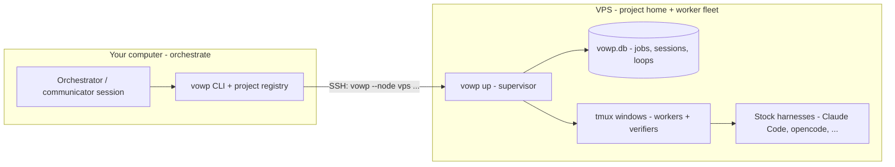
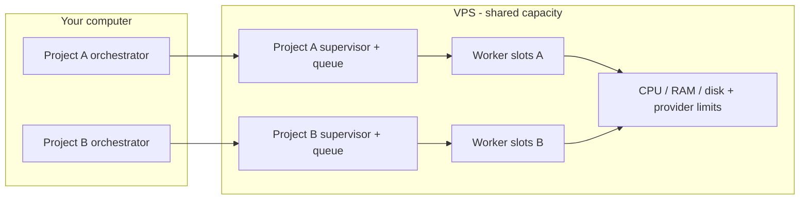
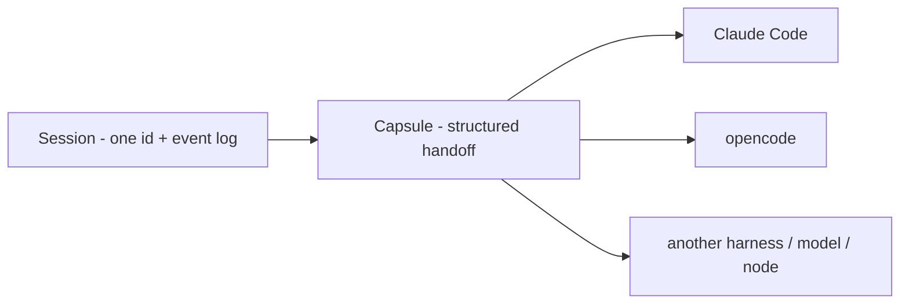

# VOWP — Virtual Open Work-to-Production

**VOWP is an open-source (MIT), VPS-first supervisor for AI coding agents.** You drive it from your
computer; the agents run as a small engineering team on your VPS.

| | |
|---|---|
| **Who it is for** | Developers and small teams with a Linux VPS who want Claude Code, opencode or another headless agent working unattended, with reviewed, gated changes. |
| **What it needs** | Your computer for orchestration and a Linux VPS for the worker fleet: SSH, `git`, `tmux` and a signed-in harness on the VPS. Rust is only needed to build from source. |
| **Install** | One `vowp` binary on both machines: `curl -fsSL https://raw.githubusercontent.com/syver777/vowp/main/scripts/install.sh \| sh -s -- --download` |
| **3-command quickstart** | `vowp init --name <your-project>`<br>`vowp doctor`<br>`vowp up` |
| **Read next** | [How it fits together](#how-it-fits-together) · [Getting started](docs/guides/quickstart.md) · [hello-vowp example](examples/hello-vowp/README.md) |

> **Status: current — early release (0.1.0).** The v0.1 command surface is implemented, but this is
> young software. The [roadmap](docs/roadmap.md) lists what is deliberately not in v0.1, and the
> [install guide](docs/guides/install.md) covers the release archives, the per-user install script and
> the systemd unit.

Work is modelled as a graph of jobs, deterministic loops keep it moving, every job runs in a tmux window
you can watch, sessions move between harnesses, models and machines without losing context, and finished
work reaches production only through guarded, reversible promotions.

VOWP does not fork or spoof a harness. It drives the official headless/JSON interfaces, keeps the
conversation in its own append-only event log, and stores no credentials. Model choices are settings in a
profile ladder, not assumptions baked into a job.

## How it fits together

**The VPS is the project home.** It holds the repository, the `vowp.toml`, the jobs and sessions
database, the worktrees and the running supervisor. Your computer is the control surface: it runs the
orchestrator/communicator session and the `vowp` CLI, and reaches the VPS over SSH.



| Your computer | The VPS |
|---|---|
| Orchestrator/communicator session | Project checkout and `vowp.toml` |
| `vowp` CLI and node registry | `$VOWP_HOME/vowp.db` (default `~/.vowp/vowp.db`) — the authoritative job/session state |
| SSH key | `vowp up` supervisor and loop engine |
| `vowp --node vps status`, `board`, `job`, `session` | Job worktrees, tmux windows, workers and verifiers |
| A local editor or browser | Harness binaries, sign-ins and provider rate limits |

The local machine does **not** need a copy of the VPS database. It needs the `vowp` binary and a node
registration (`vowp init` + `vowp node add vps <target>`) so `--node vps` can SSH to the project home.
If you prefer, skip the local install and simply SSH into the VPS to run the CLI there.

### One binary, two roles

There is no separate “local edition” and “VPS edition”. The same `vowp` binary runs on both machines;
the role comes from where the project is homed and which project configuration it reads. Install it on
both with the one-line installer above. `cargo install vowp-cli` and the npm wrapper are alternatives
for people who prefer those ecosystems; you do not need more than one.

### Multiple projects and VPS capacity

In v0.1, one VOWP home runs one project's supervisor. The supervisor lock is home-wide
(`$VOWP_HOME/supervisor.lock`, default `~/.vowp/supervisor.lock`), so a second `vowp up` for another
project in the same home exits 4 with `supervisor already running`. To home several projects on one VPS,
give each project its own `VOWP_HOME`:

```sh
# project A
cd ~/src/project-a
VOWP_HOME=$HOME/.vowp-project-a vowp init --name project-a
VOWP_HOME=$HOME/.vowp-project-a vowp up

# project B, in another terminal
cd ~/src/project-b
VOWP_HOME=$HOME/.vowp-project-b vowp init --name project-b
VOWP_HOME=$HOME/.vowp-project-b vowp up
```

Each home has its own database, supervisor lock and tmux server, so the supervisors do not collide.
They share the VPS's CPU, RAM, disk and the model providers' rate limits. In v0.1 there is no single
global scheduler across homes, so size each project's `[node] max_workers` and `max_verifiers`, and
its provider `max_concurrent` limits, to fit within the VPS capacity in total, and watch
`vowp --node vps status` / `vowp --node vps board` as you add projects.

The local orchestrator can manage several projects through one or more registered nodes; the
supervisors keep queueing and reporting, and the VPS capacity is the shared ceiling.



### Windows and interchangeable sessions

Every active job has a tmux window on the VPS that you can watch. A session is **one stable id with an
append-only event log**, not a harness-specific conversation: `vowp session switch` moves it to another
harness, model, provider or node using a structured capsule. Windows, `session chat`, `session tail
--follow` and `attach` are views onto that same work.



That is the portable part: the graph, gates and session history stay with VOWP while the harness and
provider underneath can change.

## Getting started

You need `git`, `tmux`, and a harness such as Claude Code or opencode, installed and signed in.
The [install guide](docs/guides/install.md#prerequisites) covers each requirement. Rust is only
needed if you build from source.

On macOS or Linux, one command downloads the prebuilt release for your machine, verifies its
SHA256 and installs `vowp` into `~/.local/bin`:

```sh
curl -fsSL https://raw.githubusercontent.com/syver777/vowp/main/scripts/install.sh | sh -s -- --download
```

Add `~/.local/bin` to your `PATH` if the installer says it is missing, then check:

```sh
vowp --version
```

The curl installer, `cargo install vowp-cli` and the npm wrapper are **alternative** ways to
install the same `vowp` binary; use whichever fits your machine. The
[install guide](docs/guides/install.md) lists them.

On the **VPS**, in a git repository with a remote and a clean working tree, run three commands:

```sh
vowp init --name <your-project>
vowp doctor
vowp up
```

`vowp init` writes `vowp.toml` and the framework files. Set the profile ladders in `vowp.toml` to the
harnesses and models your machine can actually run, ignore runtime state, and commit:

```sh
printf '.vowp/\n' >> .gitignore
git add -A
git commit -m "chore: initialise VOWP"
```

### Local control

On your computer, install the same binary once, create a small control home and register the VPS:

```sh
vowp init --name control
vowp node add vps <your-vps>
vowp --node vps status
```

The control project only stores the SSH target. The real project, database, worktrees and workers stay
on the VPS. If you prefer to run the CLI only over SSH, you can skip the local install.

For a single-machine trial, run the same three commands on your computer in the project instead. The
VPS layout is the production path.

The merge queue requires a clean main checkout; ignoring `.vowp/` keeps it clean as `vowp job add`
writes briefs and the supervisor writes checkpoints there. A project's `.vowp/` directory holds that
runtime content, not the node database. `vowp doctor` must report no `fail` before you start. `vowp up`
starts the supervisor and opens its tmux windows on the project home; use `vowp status`/`board` there
or `vowp --node vps status`/`board` from your computer. `vowp down` stops it cleanly.

A VOWP home runs one project in v0.1. If you want a second project on the same machine or VPS, give it
its own `VOWP_HOME`; see [Multiple projects and VPS capacity](#multiple-projects-and-vps-capacity).

Add work with `vowp job add ...` or `vowp plan "..."`, or run the
[hello-vowp example](examples/hello-vowp/README.md) first: it exercises a three-job graph with fake
adapters and needs no harness or model account. The
[Getting started guide](docs/guides/quickstart.md) walks through the first job and a clean stop;
[Install](docs/guides/install.md) covers harness setup and every prerequisite, and
[Running VOWP on a VPS](docs/guides/vps.md) covers a server deployment.

## Concepts in 60 seconds

```text
node (laptop or VPS)
└─ project               one git repository, one job graph
   ├─ job graph          jobs + needs/verifies/fixes edges
   │  └─ job             brief → worktree → gates → report → merge
   ├─ loops L1–L9        deterministic ticks dispatch, verify, merge and schedule work
   ├─ sessions           append-only event logs; move between harnesses, models and nodes
   └─ windows            tmux views: board, supervisor, planner, keeper, job-*, inbox
```

A **node home** (`~/.vowp` by default, or `$VOWP_HOME`) owns the SQLite database and session store. A
**project** is one repository registered in that home; in v0.1 one home runs one project's supervisor,
so run additional projects with separate homes. **Jobs** form a graph; **loops** move them;
**sessions** keep the conversation; **windows** are views onto running work. The
[concepts overview](docs/concepts/overview.md) has the full vocabulary.

The database is `$VOWP_HOME/vowp.db` (`~/.vowp/vowp.db` by default), never `<repo>/.vowp/vowp.db`. A
project's `.vowp/` directory holds briefs, reports and checkpoints, not the database.

## Why VOWP

- **Stock harnesses, no forks.** Claude Code and opencode are driven through their documented headless
  modes. VOWP never scrapes a TUI, never sends keystrokes to answer a dialog, and never reads or forwards
  login tokens.
- **The database is the truth for decisions; files are the truth for content.** Jobs, gates, runs and
  costs live in one SQLite database per node. Briefs, reports, session logs and blobs stay in plain files.
  Kill everything, restart, and the supervisor continues where it was.
- **Deterministic loops, LLM judgment.** A plain program ticks every 60 seconds and never "decides to
  stop". Models are used for judgment: planning, diagnosing a stall, reviewing a report, writing a
  handoff.
- **Any model, any machine.** The same job can run on Claude Code on a laptop or another harness on a
  VPS; a profile ladder decides the order.
- **Evidence over claims.** A job is done when its gates pass with recorded evidence — commands, exit
  codes, diffs, verifier findings — not when an agent says so.
- **Guarded, reversible Work → Production.** Promotions snapshot what is live, ship only the intended
  change, record a rollback command and require a human yes by default.
- **Humans are never a bottleneck for unrelated work.** A question parks one job and lands in an inbox;
  everything else keeps running.

## How it works

```
you ──► vowp CLI ──► SQLite + session logs (~/.vowp)
                         ▲
                 supervisor (vowp up)
                   ├─ L1 tick every 60 s: reconcile, dispatch, gates, merge
                   ├─ planner / keeper sessions for judgment
                   ├─ failover, inbox, schedules, watchdog
                   └─ tmux windows: board, supervisor, planner, keeper, job-*, inbox
                         │
                         ▼
              harness child processes: claude -p … / opencode run … / generic cli
```

1. **Plan the graph.** Jobs are added with `vowp job add` (or by the planner from `vowp plan`).
   Each job has a brief, owned paths, dependencies and gates.
2. **Dispatch.** L1 picks ready jobs by priority and ownership locks, creates a git worktree and branch
   `job/<id>`, opens a tmux window and starts the worker session.
3. **Work and report.** The worker changes only its owned paths, commits, runs its gates and writes a
   report with structured front-matter.
4. **Gate and verify.** Command gates record evidence; an independent verifier reads the brief, the diff
   and the evidence. Failures create bounded fix jobs.
5. **Merge.** The single merge queue rebases the job branch, runs the repository-wide checks, scans the
   diff for secrets and fast-forwards `main`.
6. **Promote.** A verified change reaches `work` or `prod` through guards, a serving snapshot, a diff of
   what is actually live, a human approval (by default), deploy and probe — with a recorded rollback.

## Documentation

Both sections have an index: [concepts](docs/concepts/README.md) and [guides](docs/guides/README.md).

| Start here | What it covers |
|---|---|
| [Concepts overview](docs/concepts/overview.md) | The vocabulary, the moving parts and where state lives. |
| [Graph and loops](docs/concepts/graph-and-loops.md) | Jobs, edges, states, gates, the L1–L9 loops and the merge queue. |
| [Sessions and switching](docs/concepts/sessions-and-switching.md) | Event logs, capsules, executors, switch and export/import. |
| [Providers and failover](docs/concepts/providers-and-failover.md) | Profiles, limits, failover, probe-back and cost receipts. |
| [Work → Production](docs/concepts/work-to-production.md) | Environments, guards, approval, deploy, probe and rollback. |

| Guides | What it covers |
|---|---|
| [Install](docs/guides/install.md) | Build from source, harness prerequisites, `PATH` install. |
| [Getting started](docs/guides/quickstart.md) | Init → doctor → first job → supervisor → inbox → down. |
| [Writing jobs](docs/guides/jobs.md) | Briefs, reports, gates, ownership and the verify/fix loop. |
| [Operating a node](docs/guides/operating.md) | `up`/`down`, status, logs, loops, backups, reindex, watchdog. |
| [Sessions](docs/guides/sessions.md) | Chat, switch, capsule, export/import and `session watch`. |
| [Running on a VPS](docs/guides/vps.md) | Dedicated user, build, harness config, systemd, SSH and firewall. |
| [Multiple nodes](docs/guides/multi-node.md) | Node registration, `--node`, SSH and cross-node sessions. |
| [Schedules](docs/guides/schedules.md) | Cron and interval schedules, missed runs, pause/resume. |

Also: [security model](docs/security.md), [troubleshooting](docs/troubleshooting.md),
[contributing](CONTRIBUTING.md) and the [security policy](SECURITY.md).

## Repository layout

| Path | Contents |
|---|---|
| `crates/vowp-protocol` | Shared types, adapter/service traits, config, `Clock`, JSON Schema export. |
| `crates/vowp-store` | SQLite schema and migrations, JSONL session logs, blobs, reindex, backup. |
| `crates/vowp-graph` | DAG, state machine, ownership overlap, dispatch planning, rendering. |
| `crates/vowp-tmux` | Safe tmux window manager and its in-memory fake. |
| `crates/vowp-adapters` | Claude Code, opencode and generic CLI adapters; classification. |
| `crates/vowp-core` | Sessions, loops, gates, ledger, schedules, promotion. |
| `crates/vowp-cli` | The `vowp` binary. |
| `framework/` | Templates, skills and agent presets installed by `vowp init`. |
| `examples/` | Runnable examples, including the three-job `hello-vowp` graph. |
| `scripts/` | Per-user install, systemd unit, watchdog, uninstall and their tests. |
| `docs/design/` | The v0.1 implementation spec. |

## License

MIT. See [`LICENSE`](LICENSE).
