# VOWP — Virtual Open Work-to-Production

**VOWP is a VPS framework for AI agents to work on projects.** It turns one Linux VPS into the
always-on **home** for a fleet of agents: a global database, one database per project, append-only
session logs, a deterministic supervisor, job graphs, loops, cron schedules, measured capacity and a
single merge queue. You talk to it from the apps you already use; the VPS owns the truth.

VOWP is not another agent harness and not a model. It drives the harnesses you already run — Claude
Code, opencode, Codex and other CLI agents — through their documented headless interfaces, keeps
their logins out of the loop, and gives them a shared home, history and delivery process. It is MIT
licensed.

## What you get

| Capability | What it means |
|---|---|
| **One home on a VPS** | The VPS owns the global DB, one DB per project, every session log, the supervisor and the snapshot. |
| **Interchangeable sessions** | A session is a harness-neutral append-only log. Switch model, harness, machine or surface with a capsule; the history stays. |
| **A built-in session database** | SQLite is the truth for decisions: jobs, gates, runs, costs, leases, capacity, schedules and inbox. Content stays in plain files. |
| **Fleet and worker tracking** | Register executor machines, track workers and see the whole fleet in one snapshot. |
| **Systematic execution** | Jobs form a DAG; deterministic L1–L9 loops keep it moving; cron and interval schedules make the work orderly. |
| **Harness and provider freedom** | Claude Code, opencode, Codex/generic CLI; profile ladders, provider limits and failover. Stock harnesses, no forks. |
| **Any surface** | opencode desktop, Claude app, `vowp chat` or MCP; SSH tunnels and no public port. |
| **Work where the files are** | An outbound Mac or Linux **agent node** can run a local chat or opencode surface and opt-in offloaded jobs; the VPS stays the only home. |
| **Guarded delivery** | Evidence gates, an independent verifier, one merge queue and reversible Work → Production. |

**Vocabulary:** a **machine** is a registered execution host — the VPS home, your Mac, a laptop. A
**job** is one unit of work; when talking about the graph, it is a **job node**. A **slot** is a
concurrency place, and a **window** is a tmux view. The CLI command `vowp node` manages SSH machines;
`vowp agent` manages the local agent node.

## How VOWP works

[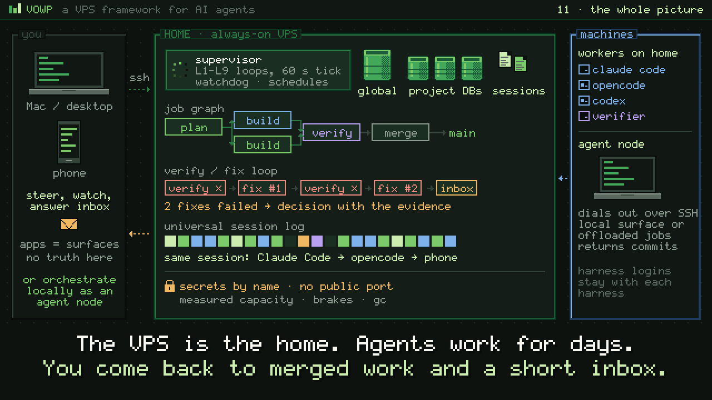](docs/media/vowp-explainer.mp4)

**▶ [Watch the two-minute pixel explainer](docs/media/vowp-explainer.mp4)** (1080p, with a chiptune soundtrack). Every
picture on this page is a frame of that video; the pictures, the music and the sound effects are made by code in
[`docs/media/src`](docs/media/README.md), so they can be regenerated when VOWP changes.

In one paragraph: you give VOWP a goal from whatever app you are in. The **home** — an always-on
VPS — stores it in a project database, a planner turns it into a **job graph**, and a deterministic
**supervisor** starts workers (stock Claude Code, opencode or Codex CLI runs) on the ready job nodes,
each in its own git worktree. Every result is checked by **gates** and an independent **verifier**;
a failure gets a bounded **fix loop**, and if two fixes fail the job is parked with an explanation in
your **inbox** while everything else keeps going. Passing work goes through a single **merge queue**.
All of it is written to the home's databases and append-only **session logs**, so the work survives a
closed laptop, a crash or a provider limit and can run for days.

### 1 · The always-on machine is the home

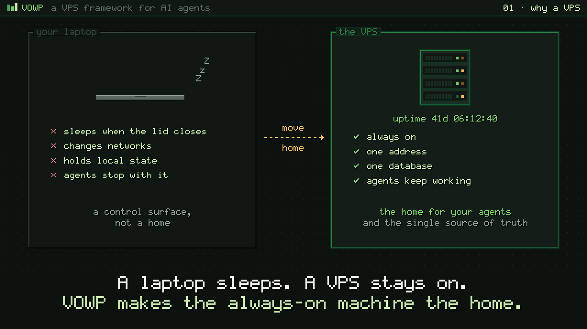

A laptop sleeps, changes networks and carries local state. A VPS stays on, has one address and one
database. VOWP puts the fleet there and makes it the **home**: the only writer and the single source of
truth. Your Mac, desktop and phone become **control surfaces** — they send commands over key-only SSH
and keep nothing but a cached snapshot.

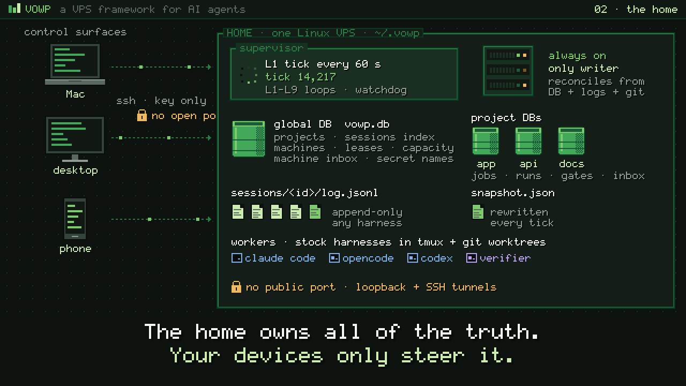

| On the home (`~/.vowp`) | What it is |
|---|---|
| **Supervisor** | One deterministic process. Ticks every 60 s for every active project, runs loops L1–L9, never "decides to stop". A watchdog restarts it. |
| **Global DB** `vowp.db` | The fleet: project registry, session index, surfaces and leases, machines and workers, capacity, provider limits, the machine inbox and secret *names*. |
| **Project DBs** `projects/<p>/project.db` | One per project: jobs and edges, runs, gate results, loops, schedules, the project inbox, ledger and releases. |
| **Session logs** `sessions/<id>/log.jsonl` | The conversation itself, append-only and harness-neutral, plus blobs, capsules and summaries. |
| **Snapshot** `snapshot.json` | The read model every surface shows, rewritten atomically each tick. |
| **Workers** | Stock harnesses in tmux windows and git worktrees. VOWP drives their documented headless modes and never touches their logins. |

The home opens **no public port**. App servers and the one-time secret page listen on `127.0.0.1` and
are reached through SSH tunnels.

### 2 · Sessions are universal

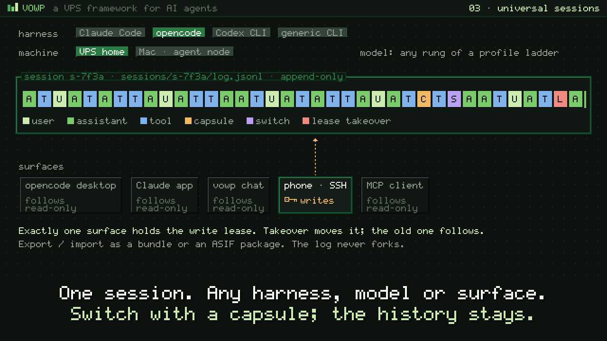

A session is one append-only event log owned by the home, not by a harness. The same session can
start in Claude Code, continue in opencode, move from the VPS to your Mac and be picked up from your
phone. A switch writes a **capsule** (a handoff document) into the log, so the next harness or model
starts with the full context. Exactly one surface holds the **write lease**; a takeover moves it and
the old surface keeps following read-only. Sessions export and import as a native bundle or an ASIF
package.

### 3 · Orchestrate on the VPS or on your own machine

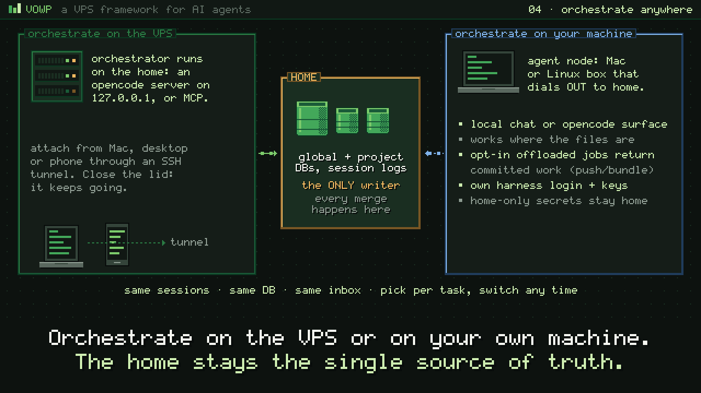

- **On the VPS:** the orchestrator runs on the home — an opencode server on `127.0.0.1` or the Claude
  app through VOWP's MCP server. Attach from any device through a tunnel; close the lid and it keeps
  going.
- **On your machine:** enroll your Mac or Linux box as an **agent node**. It dials *out* to the home,
  runs a local chat or opencode surface where your files are, and can take opt-in offloaded jobs that
  return committed work. It has its own harness login and keys; home-only secrets never leave the home.

Either way it is the same session, the same databases and the same inbox, and you can switch between
them per task.

### 4 · A global database and one database per project

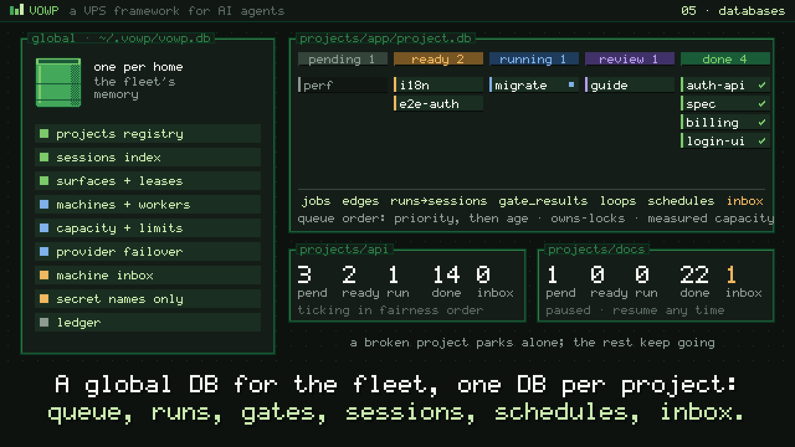

SQLite is the truth for **decisions**; plain files are the truth for **content** (briefs, reports,
logs). The global DB knows the fleet; each project DB knows its own queue — what is pending, ready,
running, in review and done — plus every run, gate result, schedule and inbox item. Projects tick in
fairness order and are isolated: one can be paused or broken while the rest keep running. Kill
everything, restart, and the supervisor reconciles from the databases, the logs and git.

### 5 · Goals become a job graph

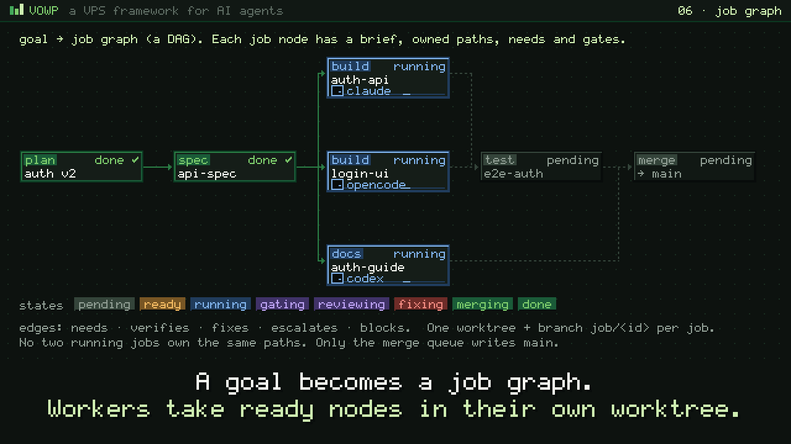

A **job node** is one unit of work with a contract: a brief, the paths it **owns**, the jobs it
**needs** and the **gates** that decide when it is done. Edges are `needs`, `verifies`, `fixes`,
`escalates` and `blocks`. The supervisor dispatches only `ready` nodes, by priority then age, after
checking measured capacity, provider limits and ownership locks — no two running jobs may own the same
paths. Each job gets its own worktree and branch `job/<id>`, and only the merge queue writes `main`.

| Worker role | Does |
|---|---|
| `planner` | Turns goals into jobs, reprioritises, reviews reports. |
| `worker` | Builds, tests, writes docs — runs a job from its brief. |
| `verifier` | Independently checks a report, diff and evidence; returns pass or findings. |
| `keeper` | Diagnoses stalls and failures: nudge, restart, replan, park or fail. |

### 6 · Verify → fix → inbox

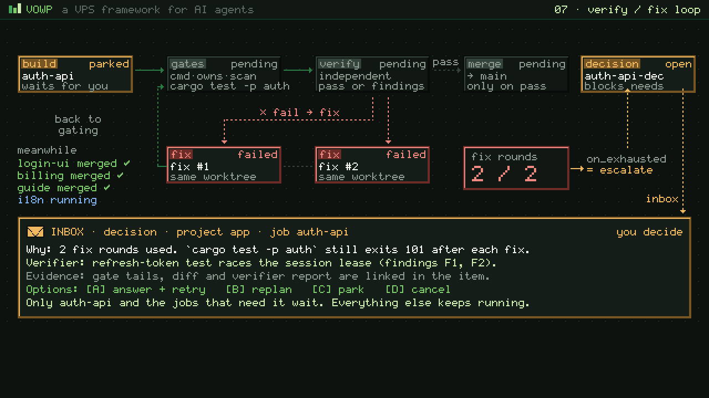

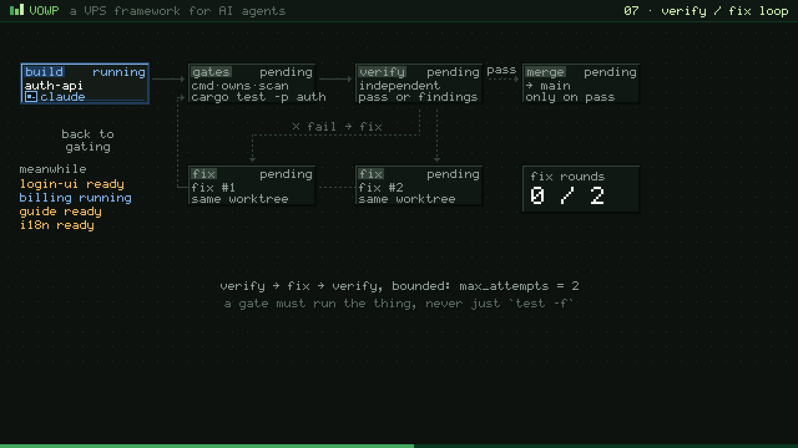

1. A worker finishes and writes a report. **Gates** run in the job's worktree: the report, commands
   such as `cargo test`, `owns_respected` and `secret_scan`. A gate must *run* the thing — `test -f`
   style checks are rejected.
2. An independent **verifier** reads the brief, diff and evidence and returns pass or concrete findings.
3. On a failure a **fix job** runs in the *same* worktree with every finding at once, then the job goes
   back to gating. This is bounded: `max_attempts` defaults to **2** fix rounds.
4. When both fixes fail, `on_exhausted = escalate` creates a **decision job** and an **inbox item**:
   why it failed, the gate tails, the verifier's findings and your options (answer and retry, replan,
   park, cancel). The same happens when one action repeats three times without new evidence.
5. Only that job and the jobs that need it wait. Every other job and project keeps running. Your answer
   unparks it.

### 7 · Long-horizon work, for days

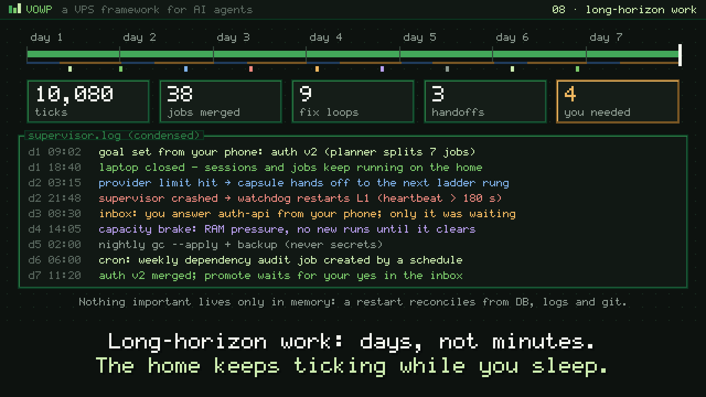

Because the home is always on and nothing important lives only in memory, VOWP can work on one goal
for days:

- **Lid closed?** Sessions and jobs keep running on the VPS.
- **Provider limit?** L6 failover writes a capsule and hands off to the next rung of the profile
  ladder, then probes the limited provider after its reset. It never moves work to an unlisted paid
  provider.
- **Crash or reboot?** The watchdog restarts the supervisor when the heartbeat is older than 180 s, and
  the next tick reconciles runs, jobs and leases.
- **Machine under pressure?** Capacity is measured every tick; a brake stops *new* runs on memory, swap,
  disk or provider pressure and never kills a running job.
- **Recurring work?** Cron and interval schedules create jobs, trigger loops or run commands; missed runs
  collapse to one.
- **Housekeeping?** A nightly `gc --apply` and backups keep the disk bounded without ever deleting
  production, truth, open work or secrets.

You check in from your phone, answer the few inbox items that need a human and come back to merged
work.

### 8 · Secrets by name

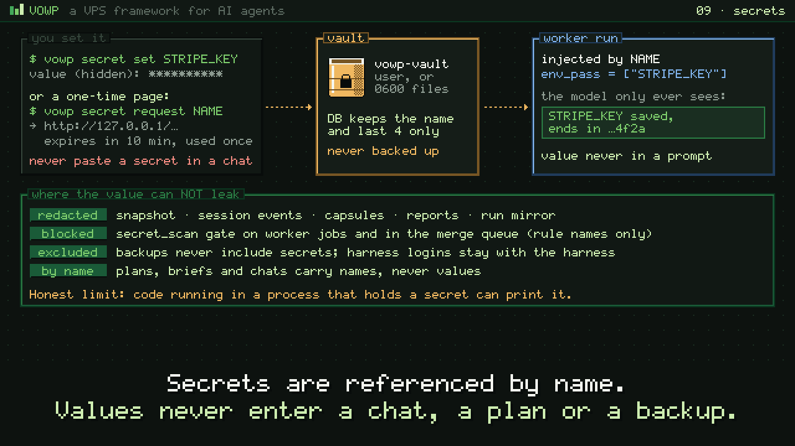

You enter a value through a hidden prompt (`vowp secret set NAME`) or a one-time page on `127.0.0.1`
that expires in ten minutes (`vowp secret request NAME`). The database stores only the name and last
four characters. A worker gets the value injected by **name** through its harness's `env_pass` list;
the model sees `NAME saved, ends in …4f2a`. Values are redacted from the snapshot, session events,
capsules and reports, blocked by the `secret_scan` gate and the merge queue, and never backed up. The
honest limit is stated [below](#secrets-honestly).

### 9 · One merge queue and guarded Work → Production

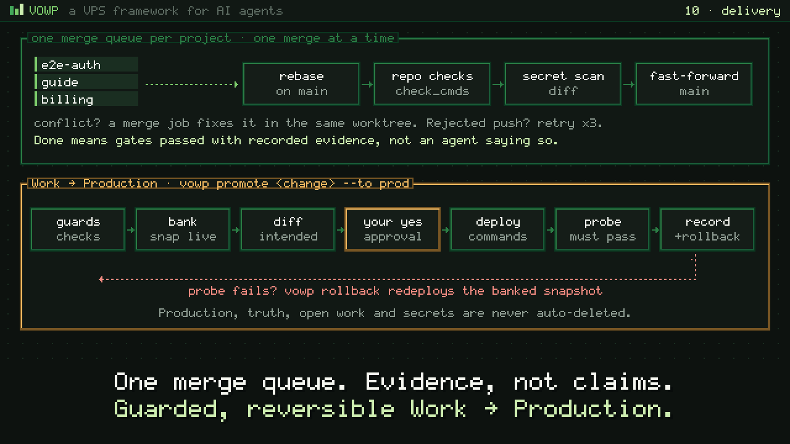

A job is done when its gates pass with recorded evidence, not when an agent says so. One merge runs at a
time per project: rebase onto `main`, run the repository checks, scan the diff for secrets,
fast-forward and push. A conflict becomes a merge job in the same worktree. Shipping is a separate step:
`vowp promote` runs guards, snapshots what is live, checks the diff is exactly the intended change,
waits for your approval in the inbox, deploys, probes and records the rollback command.

## Set up VOWP 0.4.0

Paste this prompt into Claude Code, opencode or another harness on the computer you want to use as
the control machine:

```text
Set up VOWP 0.4.0 for me. Read
https://raw.githubusercontent.com/syver777/vowp/v0.4.0/docs/setup/agent-setup.md
and follow it exactly. Ask me only what it tells you to ask, show me the full plan once,
and run it after I approve. Never ask me to paste a secret into this chat.
```

The harness reads the [setup contract](docs/setup/agent-setup.md), installs the pinned CLI locally if
it is missing, asks five questions in one message, shows the whole plan without changing the home,
and runs it after one approval. The local per-user CLI install is the only change before that
approval, and the harness tells you about it in the question message. It stops for the human
hand-offs — a printed sudo command (only if one is needed), a harness sign-in, a secret entered
through the hidden prompt or a one-time link — and then runs the verification. The setup commands do
the real work, so the result does not depend on which harness runs the prompt.

What you need before you paste it:

- **A home:** one Linux VPS on `x86_64` or `arm64`, reachable with key-only SSH. The setup can create
  a non-root `vowp` user when passwordless sudo is available; otherwise it runs as the SSH user.
- **A harness:** Claude Code or opencode installed and signed in **on the home**, with its own login
  flow. VOWP drives the documented headless interface and never reads the login.
- **A control machine:** this computer, Linux or macOS with `ssh`. It holds only derived state: a
  snapshot cache, an event spool and its tunnel records. A phone can join later with an SSH app and
  the owner's key.
- **A repository, optionally:** an existing checkout on the home with a `vowp.toml`, or no project
  yet. Setup registers repositories; it does not clone or rewrite them.

> **Status: current — VOWP 0.4.0.** The v0.4 command surface, including the setup commands, the
> loopback window, outbound agent nodes, local surfaces, opt-in offload and the hardening work, is
> implemented. The ASIF interchange is a review draft (below). The release process owns the 0.4.0
> tag and published binaries. The [roadmap](docs/roadmap.md) lists what is deliberately deferred.

## What the supervisor does

- **Runs one fleet, not one project.** One supervisor ticks every active project in fairness order.
  A project can be paused, resumed, archived or removed; a broken project parks alone while the rest
  keep running. Project weights decide the tick order.
- **Turns a goal into a job graph.** Jobs carry a brief, owned paths, dependencies and gates. L1
  dispatches ready work into a git worktree and a tmux window; L2 continues a run; L3 verifies it
  independently; the single merge queue rebases, re-runs the repository checks, scans the diff and
  fast-forwards `main`.
- **Keeps the conversation in VOWP.** Sessions are harness-neutral, append-only event logs. A session
  can move between models, harnesses and surfaces with a capsule; a takeover cuts the old surface off
  within the lease rules and leaves it in follow mode.
- **Measures capacity instead of guessing.** The sampler reads the host, every run records its own
  usage, and admission checks the brake, provider limit, target, RAM, CPU and disk before a run
  starts. A job that cannot start stays ready with the reason on the board.
- **Keeps secrets by name.** Values are entered through a hidden prompt or a one-time loopback page,
  never in an argument, a plan or a chat. Injection is by name, and exact-value redaction covers the
  session and snapshot paths described below.
- **Classifies every file.** Production, truth, open work and secrets are never auto-deleted; closed
  sessions, run output, worktrees, samples and caches have bounded retention and a dry-run `gc`.
- **Sets itself up with a plan.** The setup plan prints every phase, command and file. The home and
  control commands apply it idempotently, stop at a human hand-off with exit 5, and the verify step
  proves a fixture job merges, the snapshot is readable from the control machine and an orchestrator
  answers through the chat fallback.

## Fleet and capacity

```text
 measure ──────────────► admit ──────────────► brake
 each tick              before each run        stops new runs
 host + per-run         target, RAM, CPU,      memory pressure,
 usage + estimates      disk, provider         swap growth, disk,
                                               provider limits
        │
        └──────────────► advise ──────────────► owner decides
                         every 30 min and       capacity set --target N
                         on events              (the AI only proposes)
```

Capacity is measured from the machine, admitted deterministically and advised by a model that never
changes the target itself. The default mode is `auto`, derived from the latest host sample and the p90
estimates. The owner can set a fixed target; a target above the advice needs an explicit override and
is shown as an owner override, and the brakes still apply. A brake only stops new admissions — it
never kills a running job. A job that waits says why (`waiting: RAM 1.2 GB short`), and the same
sentence appears in the queue and the snapshot.

On a host without `/proc` (macOS or a minimal container), the sampler says `fallback`: auto proposes
1, RAM and CPU checks are skipped, and the disk check still runs. There is no cost cap; cost
is reported separately as receipts, labelled estimates or `unknown`. See
[Capacity](docs/concepts/capacity.md).

## Data lifecycle

Every file VOWP creates has a class, and the class decides whether it may ever be deleted:

| Class | Examples | Default |
|---|---|---|
| **Production** | releases, rollback snapshots, serving banks, prod pointers | **Never auto-deleted.** |
| **Truth** | global and project databases, capsules, passing gate evidence, decisions and ledger, backups, archived project data | **Never auto-deleted**; backed up. |
| **Open work** | unmerged or unpushed worktrees, active sessions, orchestrator sessions, the live lock and heartbeat | **Never auto-deleted.** |
| **Secrets** | the secret store and vault files | **Never auto-deleted**, never backed up in plain text. |
| **Closed sessions** | `log.jsonl` and blobs after the session closes | Kept 30 days, then compacted to a capsule + summary. |
| **Run output** | `runs/*.jsonl`, `*.stderr` | 14 days; compressed after 1 day. |
| **Worktrees** | a merged job's worktree; a failed, cancelled or replanned job's worktree | Removed after merge; kept 7 days after a failed terminal state. |
| **Samples** | host samples and 5-minute capacity rollups | Raw samples 48 hours; rollups 30 days. |
| **Cache** | disposable `tmp/` files | 24 hours. |

`gc` is a dry run that lists files by class; `gc --apply` removes only the expired
disposable classes after compacting closed sessions. It never removes production, truth, open work or
secrets, never the main checkout, and never deletes a session row. A nightly schedule runs
`gc --apply`. Backups include the global database, every project database and the session content,
never secrets. See [Data lifecycle](docs/concepts/data-lifecycle.md).

## ASIF interchange (v0.4, review draft)

The current tree adds a second session interchange format beside the native bundle:
`vowp session export <id> --format asif` writes a deterministic `.asif.zip`, and
`vowp session import <file> --format asif` creates a new idle session from that package, a
standalone `session.json`, a directory or stdin. The daemon window links the same download, serves
a loss preview and has an `/import` page whose upload is token-gated. `--format bundle` remains the
default and is unchanged.

ASIF 0.4 is a review draft. Every command reports its declared losses and the VOWP operations that
are not captured; `--strict` refuses blocking or integrity losses, and `--allow-loss` accepts the
recoverable ones as declared losses. The interchange does not claim ASIF conformance, an exact or
lossless round trip, portable continuation or native-harness import. Jobs, gates, leases and
project rows are not in the package. See the
[ASIF integration design](docs/design/v0.4/asif-integration.md).

## Secrets, honestly

VOWP refers to a secret by **name** only. `secret set NAME` reads the value from a hidden prompt;
`secret request NAME` opens a one-time page on `127.0.0.1` with a ten-minute expiry and returns only a
name, URL and expiry. The AI sees `NAME saved, ends in …last4`, never the value.

- **Vault-user mode** stores files under the separate `vowp-vault` user when sudo can create it.
- **Basic mode** stores them under `~/.vowp/secrets/` owned by the runtime user at mode 0600. Basic
  mode does not separate the value from the agent's user; the harness runs as that same user.
- Injection is by name through a harness's `env_pass` list. The promoter does not add a secret
  environment to deploy commands in this build.
- Exact-value redaction covers session-service and remote-ingest events, the snapshot, capsules and
  the finished report and run mirror. It does **not** cover the supervisor log, gate command evidence,
  ledger rows, the switch turn path or the `session watch` importer in this build, so a command that
  prints a secret can still persist it there.
- **The honest limit:** any agent that can run arbitrary code inside a process that holds a secret can
  print it. Vault mode keeps the files out of the runtime user's direct readable tree, but the helper
  that reads them is a broad trust boundary. Neither mode encrypts the store at rest. Harness logins
  stay under the harness's own control, and a secret pasted into a chat is already in the model
  provider's transcript — rotate it and use the safe path. Secrets are never included in a backup.

The [security model](docs/security.md) states the full coverage and the remaining gaps.

## Why a VPS framework

- **One VPS, not one laptop.** The home stays on; sessions, jobs, workers, schedules and history
  survive a closed lid, and any surface can reconnect to the same session.
- **Stock harnesses, no forks.** Claude Code and opencode are driven through their documented
  headless modes. VOWP never scrapes a TUI, sends keystrokes to answer a dialog, or reads and forwards
  login tokens.
- **The database is the truth for decisions; files are the truth for content.** Jobs, gates, runs,
  costs and leases live in the global and project databases. Briefs, reports, session logs and blobs
  stay in plain files on the home. Kill everything, restart, and the supervisor reconciles.
- **Deterministic loops, LLM judgment.** A plain program ticks and never "decides to stop". Models are
  used for planning, diagnosis, review, handoff and capacity advice.
- **Any model, any machine, any surface.** A model is a rung in a profile ladder. The same session can
  run on Claude Code on a laptop or opencode on the home, and continue from another app.
- **Evidence over claims.** A job is done when its gates pass with recorded evidence — command, exit
  code, duration, output and verifier findings — not when an agent says so.
- **Guarded, reversible Work → Production.** Promotions snapshot what is live, ship only the intended
  change, record the rollback and require a human yes by default.
- **Humans are never a bottleneck for unrelated work.** A question parks one job and lands in an
  inbox; every other project keeps moving.

## Documentation

| Start here | What it covers |
|---|---|
| [Explainer video and diagrams](docs/media/README.md) | The two-minute pixel video, every diagram on this page and the code that draws them. |
| [Wiki](https://github.com/syver777/vowp/wiki) | The same walkthrough as this README, one page per idea. |
| [What is VOWP](docs/concepts/what-is-vowp.md) | The VPS framework in one page: home, sessions, database, fleet, graphs, schedules and harnesses. |
| [Setup contract](docs/setup/agent-setup.md) | The exact prompt contract: ask once, show the plan once, run it, stop at hand-offs, verify, report. |
| [Concepts overview](docs/concepts/overview.md) | The vocabulary, the moving parts and where state lives. |
| [Home and surfaces](docs/concepts/home-and-surfaces.md) | One supervisor for many projects, leases, takeover, remote execution, app hosts, MCP and chat. |
| [Capacity](docs/concepts/capacity.md) | Measurement, admission, brakes, targets and the advisor. |
| [Data lifecycle](docs/concepts/data-lifecycle.md) | Classes, `gc`, compaction, backup and restore, migration. |
| [Graph and loops](docs/concepts/graph-and-loops.md) | Jobs, edges, states, gates, L1–L9 and the merge queue. |
| [Sessions and switching](docs/concepts/sessions-and-switching.md) | Event logs, capsules, executors, surfaces and handoff. |
| [Providers and failover](docs/concepts/providers-and-failover.md) | Profile ladders, shared provider limits and cost receipts. |
| [Work → Production](docs/concepts/work-to-production.md) | Environments, guards, approval, deploy, probe and rollback. |
| [Install](docs/guides/install.md) | The setup path, prerequisites, the manual binary install and the on-disk layout. |
| [Getting started](docs/guides/quickstart.md) | The first project, the first job, the fleet view and an orchestrator. |
| [Writing jobs](docs/guides/jobs.md) | Briefs, reports, gates, ownership and the verify/fix loop. |
| [Operating a home](docs/guides/operating.md) | `up`/`down`, fleet views, capacity, logs, backup, `gc` and migration. |
| [Sessions](docs/guides/sessions.md) | Chat, takeover, switch, capsule, export/import and `session watch`. |
| [ASIF interchange (review draft)](docs/design/v0.4/asif-integration.md) | The `--format asif` CLI, declared losses, strict mode and the daemon download/import routes. |
| [Running a home on a VPS](docs/guides/vps.md) | The server account, harnesses, systemd, SSH and firewalls. |
| [Control machines and extra machines](docs/guides/multi-node.md) | Routing, snapshot cache, tunnels, executor machines and cross-machine sessions. |
| [Schedules](docs/guides/schedules.md) | Cron and interval schedules, missed runs, pause and resume. |

Also: [security model](docs/security.md), [troubleshooting](docs/troubleshooting.md),
[contributing](CONTRIBUTING.md), the [v0.2 specification](docs/design/v0.2/home-and-surfaces.md),
the [CLI reference](docs/reference/cli.md) and the [roadmap](docs/roadmap.md).

## Limits of v0.4

- **One home.** There is no replication, leader election or multi-home scheduling.
- **Local execution is opt-in.** A Mac or Linux machine can join as an outbound agent node and run a
  local surface or an offloaded job, but the VPS remains the only home and the only writer. Offload
  is off by default; a project must opt in.
- **Loopback window, separate daemon.** The web window and HTTP/SSE API are served by `vowp-daemon`
  on `127.0.0.1` only. The archives and npm package install `vowp` only, so install the daemon
  separately for the window; without it the supervisor runs without a window.
- **SSH is the default transport.** The agent dials the home over SSH stdio. The optional WSS path
  needs an owner-operated TLS reverse proxy; there is no hosted relay. A control machine still needs
  key-based, batch-mode SSH to the home.
- **Offload returns committed work only.** A push or bundle result carries committed git objects;
  uncommitted files stay on the node, and home-only secrets are never offloaded.
- **ASIF is a review draft.** Session export/import reports declared losses and does not claim ASIF
  conformance, a lossless round trip or native-harness import.
- **Apps keep their own limits.** VOWP can configure and host an app; it cannot close another vendor's
  window or force an app build to expose MCP tools.
- **One operator.** Multi-user accounts, quotas, roles and audit are not in v0.4.
- **Linux home, Linux/macOS control and agent nodes.** Windows is not supported, and there is no
  native VOWP desktop app; the apps are the surfaces.

## Repository layout

| Path | Contents |
|---|---|
| `crates/vowp-protocol` | Shared types, events, config, adapter/service traits, `Clock`, JSON Schema export. |
| `crates/vowp-store` | Global and per-project SQLite schemas, migrations, JSONL session logs, blobs, reindex, backup. |
| `crates/vowp-graph` | DAG, state machine, ownership overlap, dispatch planning, rendering. |
| `crates/vowp-tmux` | Safe tmux window manager and its in-memory fake. |
| `crates/vowp-adapters` | Claude Code, opencode and generic CLI adapters; usage scopes and classification. |
| `crates/vowp-core` | Sessions, loops, gates, ledger, schedules, capacity, surfaces, vault, lifecycle, promotion. |
| `crates/vowp-cli` | The `vowp` binary, including setup, control, fleet, capacity and MCP. |
| `framework/` | Templates, skills and agent presets installed by project initialisation. |
| `examples/` | Runnable examples, including the three-job `hello-vowp` graph. |
| `scripts/` | Per-user install, systemd unit, watchdog, uninstall and their tests. |
| `docs/` | User concepts and guides, the setup contract, reference and design specs. |
| `docs/images/`, `docs/media/` | The README diagrams, the explainer video and the Python code that draws both. |

## License

MIT. See [`LICENSE`](LICENSE).
